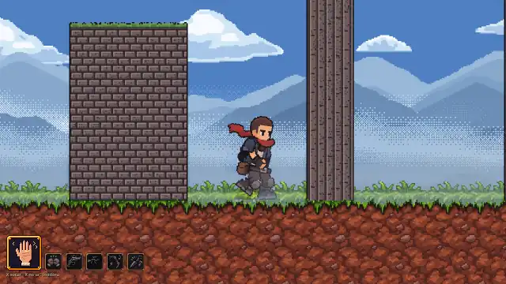
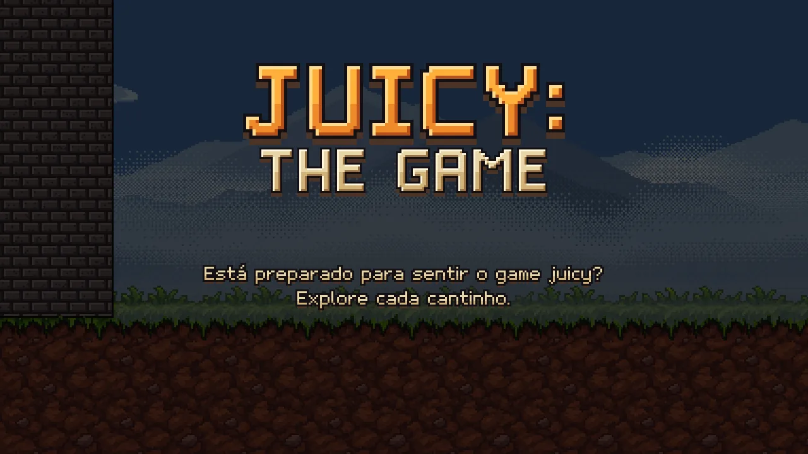
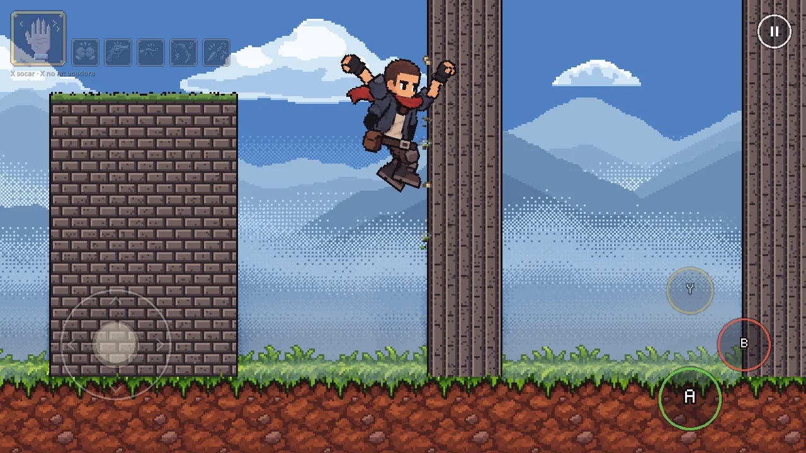
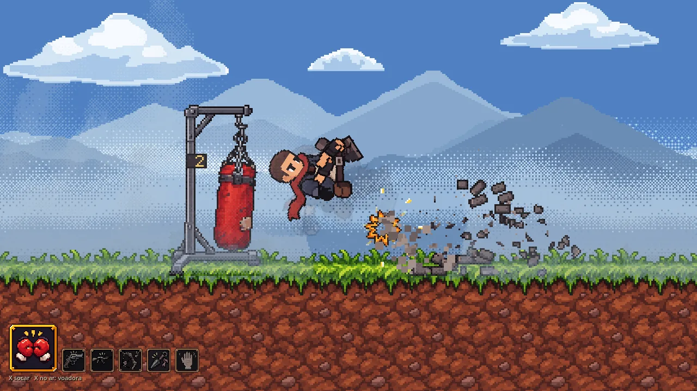
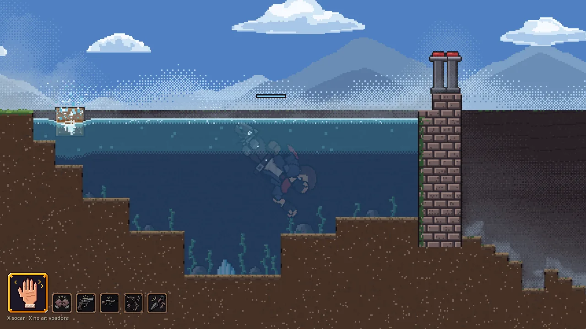
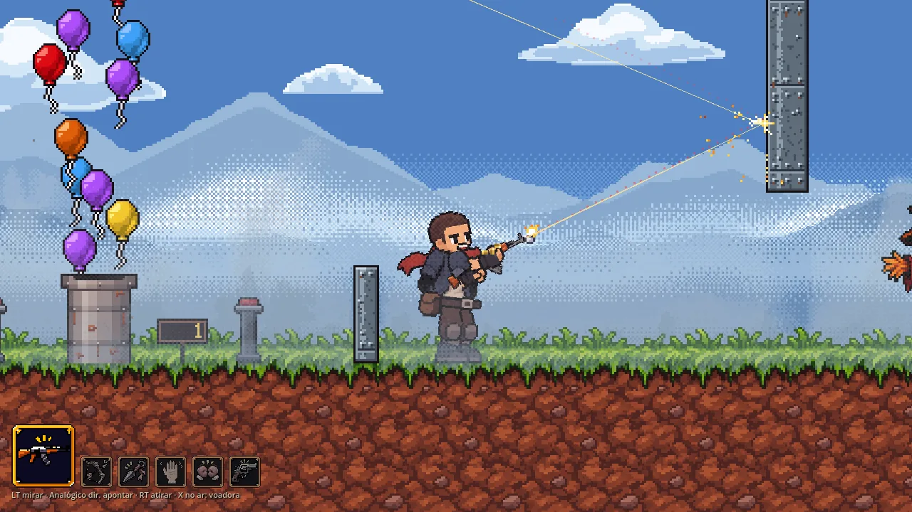
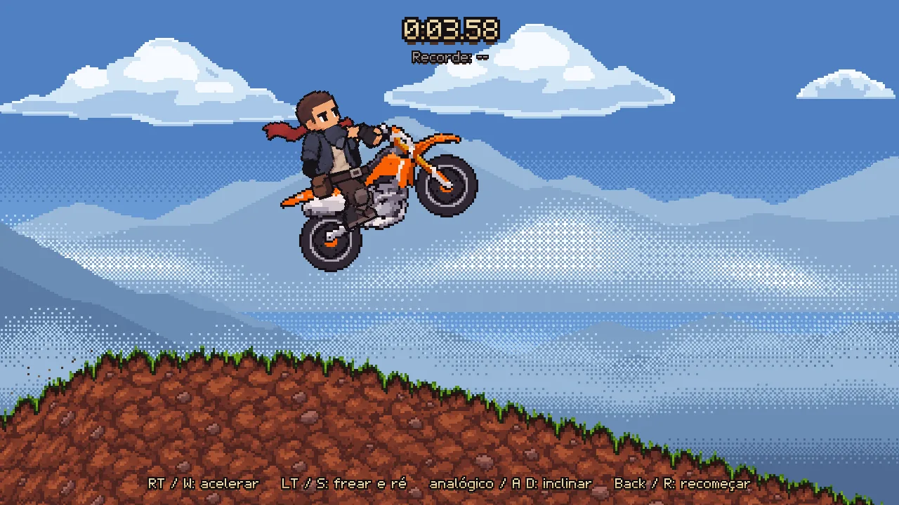

# Juicy: The Game

> A 2D pixel-art action platformer made with Godot 4.7, with touch and gamepad controls and a strong focus on game feel.



## What the game is

Juicy: The Game is a side-scrolling platformer about how a game feels in the hands. You control an adventurer with a red scarf. The character has a large set of moves, six weapons and a lot of feedback: screen shake, hit stop, rumble and sound on each action.

The game has two modes, which you select on the title screen:

- **Aventura (Adventure):** one long level. You climb stone columns, crawl through a dark tunnel, train in combat areas, swim in a river with a dam, and push the last wall until the roof comes down.
- **Motocross:** a time trial on a dirt bike, with ramps, flips and a best time for the session.

The in-game text is in Portuguese.

## Gallery

| | |
|:-:|:-:|
|  |  |
| Title screen with the two modes | Wall kick, with the touch controls on screen |
|  |  |
| Flying kick through a breakable wall | Dive in the river |
|  |  |
| Rifle burst with a ricochet off a steel plate | Jump in the Motocross mode |

## Features

### Movement

- Walk and run with analog speed. Hold sprint for more speed.
- Skid turn when you reverse direction at sprint speed.
- Variable jump height, with coyote time and a jump buffer.
- Directional double jump.
- Wall cling and wall slide on any vertical wall. Hold down to slide faster.
- Long wall jump away from the wall, and a short wall kick up the same wall.
- Automatic ledge grab. From the ledge, climb up, drop down or leap back.
- Crouch and crawl. The character crouches automatically under a low ceiling.
- Automatic step up on small steps.
- Dodge in place, roll forward and roll back, with invulnerability frames.
- Look up and look down when you hold the stick while you stand still.
- Hero landing after a long fall.
- Push crates and tall walls.
- Swim on the surface and dive under the water, with an oxygen bar.

### Combat

- Six weapons: bare hands, boxing gloves, revolver, AK rifle, bow and kunai.
- Punch combo: jab, jab, cross and uppercut.
- Flying kick in the air with any weapon. It bounces off walls and crates.
- Kunai strike: the character vanishes in smoke, dashes and slashes.
- Bow with a charged shot and a dotted trajectory preview.
- Revolver and automatic rifle with a laser sight. The rifle fires in bursts with spread.
- Ricochet surfaces that reflect bullets, arrows and blades. A ricochet can hit the shooter.
- The weapon goes into the holster automatically on walls, on ledges and on the bike.

### World

- Stone columns to climb, with a reward flag on top.
- A low, dark tunnel lit by a torch around the player.
- Training areas: a chair and a bed to sit and sleep, a punching bag, a breakable brick wall, scarecrows, a cup table for arrows, a balloon launcher with a score board, a swinging spike trap and a turret.
- A river with a dam. Buttons open the dam and fill the river again. Crates float on the water.
- A final wall that ends the game with a collapse sequence.
- Animated pixel-art fog, camera zones and parallax backgrounds.

### Feel and feedback

- Sound effects synthesized in code at load time, with variants for each surface and a muffled sound under the water.
- Gamepad rumble on two motors, and phone vibration for the touch buttons.
- Screen shake and hit stop on hits, breaks, landings and damage.
- Camera look-ahead when you sprint.

### Platforms and input

- Windows and Android builds.
- Keyboard, mouse, gamepad and touch.
- The pause menu shows the controls for the gamepad or for the keyboard.
- When a gamepad disconnects, the game pauses.

## Controls

| Action | Keyboard and mouse | Gamepad | Touch |
|---|---|---|---|
| Move | A / D or Left / Right | Left stick | Left stick |
| Look up, climb, swim up | W or Up | Left stick up or D-pad up | Left stick up |
| Crouch, look down, dive | S or Down | Left stick down or D-pad down | Left stick down |
| Sprint | Shift | RB | Push the left stick to its edge |
| Jump | Space | A | A button |
| Dodge or roll | K | B | B button |
| Attack | J | X | X button (when a weapon is out) |
| Interact | E | Y | Y button |
| Previous weapon | Q | D-pad left | |
| Next weapon | R | D-pad right | Tap the weapon bar |
| Aim (revolver, rifle, bow) | L or right mouse button | LT, aim with the right stick | Aim stick |
| Fire | J or left mouse button | RT | Release the aim stick |
| Pause | Esc | Start | Pause button |
| Debug HUD | F1 | Back | |
| Bike: throttle | W or Up | RT or A | RT button |
| Bike: brake | S or Down | LT or B | LT button |
| Bike: lean back or forward | A / D or Left / Right | Left stick or D-pad left / right | Left stick |
| Bike: restart | R | Back | Restart button |
| Bike: get on or off | E | Y | Y button |

The touch controls show only on a device with a touch screen. They hide when you use a keyboard or a gamepad, and come back on the next touch.

## Download

Get the builds from the [v1.0 release](https://github.com/salvimateus/juicy-the-game/releases/tag/v1.0):

- **Windows:** `juicy-the-game.exe`. The file has no code signature, so Windows SmartScreen can show a warning. Select "More info", then "Run anyway".
- **Android:** `juicy-the-game.apk`. Allow the installation of apps from unknown sources on your device, then open the file to install it.

## Run from source

1. Install [Godot 4.7](https://godotengine.org/download) (the standard version, not the .NET version).
2. Clone the repository:

   ```sh
   git clone https://github.com/salvimateus/juicy-the-game.git
   ```

3. Open Godot, select "Import" and open `project.godot`.
4. Wait for the first import of the assets.
5. Press F5 to run the main scene, `res://game/main.tscn`.

The project uses the Compatibility renderer on desktop and on mobile.

## Export

The project has two presets in `export_presets.cfg`:

- **Windows Desktop:** x86_64, with the PCK embedded in the `.exe`.
- **Android:** arm64-v8a only, with no Gradle build.

Before you export, do these steps:

1. Install the export templates for Godot 4.7 (Editor > Manage Export Templates).
2. Open Project > Export and select a preset.
3. Change the export path. The presets point to an absolute `build/` folder on the machine of the author.
4. On the Windows preset, clear the "Custom Template > Release" field. It points to a custom template build that is not in this repository. With the field empty, Godot uses the official template.
5. On the Android preset, set a release keystore in the preset or in Editor Settings, because the preset signs the APK. You can also export a debug build with the debug keystore.

## Project structure

- `game/`: all the gameplay code and scenes: player, level, camera, combat, targets, interactables, water, swim, fog, lighting, ending, motocross, UI, touch controls and the capture tools.
- `rig/`: the skeletal rig of the adventurer: bones, poses, animation clips and effect sprites.
- `assets/`: the PNG parts of the character rig, the props and weapons, and the bike sprites.
- `audio/`: the `Sfx` autoload, the sound synthesizer, its tuning and the sound board.
- `feedback/`: the `Haptics` autoload and the rumble profiles.
- `icons/`: the Android launcher icons.
- `tools/`: a pose sheet renderer for the rig and Python scripts for the art.
- `scenes/` and `scripts/`: an older test scene and its scripts.
- `images-codex/`: a source image that Godot does not import.
- `docs/`: the screenshots of this README.
- `PRIMITIVES.md`: an inventory of the shared contracts of the code. Read it to learn the systems fast.

## Debug and test tools

### In the game

- Press **F1** (or Back on the gamepad) to show the debug HUD. It shows the player state, the speed, the current action, the floor, the wall contact, the stick input and the FPS. It also has controls for the rumble and the fog.
- Press **F2** to open the sound board. It plays each sound effect and each rumble profile.

### Capture mode

The game can replay a recorded input script and save PNG screenshots at marked times. Put the game arguments after `--`:

```sh
godot --path . -- --capture <output dir> --script <script name>
```

- The scripts are in `game/input_scripts.gd`. Examples: `locomotion`, `walls`, `areas`, `swim`, `guns`, `bow`, `ricochet`, `tunnel`, `ending`.
- Without `--script`, the game saves one screenshot after 10 frames (change it with `--frames N`) and quits.
- Add `--with-title` to keep the title screen in a capture.
- Add `--fixed-fps 60` before `--` for the same timing on each run.

The Motocross stage has its own capture driver:

```sh
godot --path . res://game/moto/moto_level.tscn -- --capture <output dir> --script moto_ramp
```

### Other arguments

Put these arguments after `--`:

- `--touch-ui`: show the touch controls on a desktop.
- `--touch-mouse`: send mouse clicks as touch events.
- `--fog-off`: turn off the fog.
- `--sfx-dump <dir>`: write each synthesized sound effect as a `.wav` file, then quit.
- `--haptics-sim`: print the rumble timeline, then quit.

### Pose sheet

Render poses of the rig in a PNG grid:

```sh
godot --path . res://tools/pose_sheet.tscn -- --pose-sheet <spec> --phases 0,0.25 --out <output dir>
```

## Status

Version 1.0 is out for Windows and Android. The game has one Adventure level and one Motocross stage. The game does not save progress or settings. The best Motocross time stays only until you close the game.

## License

The code is under the MIT License. See [LICENSE](LICENSE).
